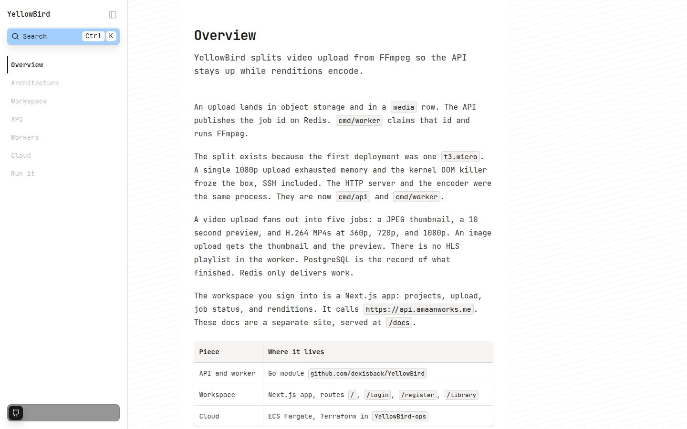
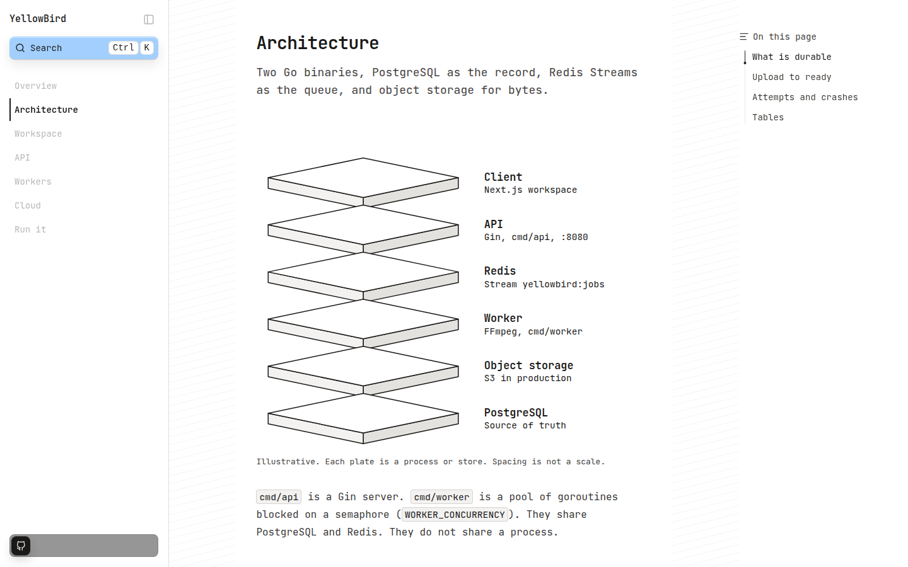
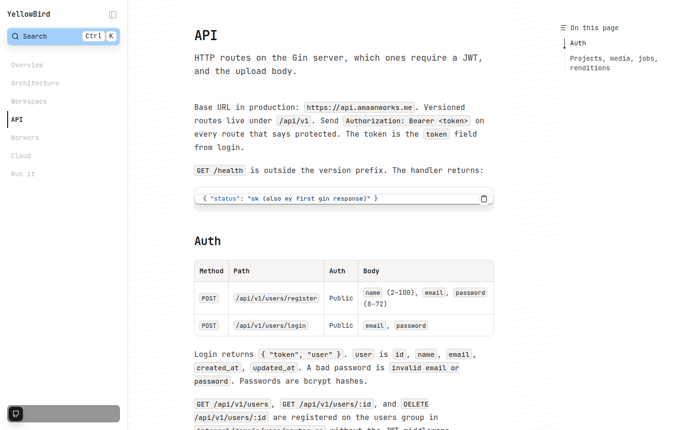

# YellowBird docs

Documentation for YellowBird, the Go media pipeline. This repository is its own site. It is not a route inside `yellowbird-web`.

The public URL is [https://yellowbird.amaanworks.me/docs](https://yellowbird.amaanworks.me/docs). The app is built with `base: /docs`, so every page and asset already includes that prefix. A host in front of this build should serve the `dist` directory at that path.







## Requirements

Node.js 22.23.4 or newer. Astro 7 refuses older 22.x releases. `.nvmrc` pins 22.23.4.

## Scripts

```bash
npm install
npm run dev
```

Dev server: [http://localhost:4321/docs](http://localhost:4321/docs).

```bash
npm run build
npm run preview
```

`npm run build` loads `scripts/register-react-opts.mjs` first. Astro 7's static build imports a virtual `astro:react:opts` module that Node cannot resolve on its own. Dev and preview do not need that loader.

## Add a page

Put an MDX file in `content/docs`. The frontmatter needs `title` and `description`. Add the slug to the `pages` array in `content/docs/meta.json`. The sidebar order is that array.

```mdx
---
title: Example
description: One sentence that can stand as the meta description.
---

The first paragraph should say what the page is for.
```

Internal links are relative (`./workers`). The site origin is `https://yellowbird.amaanworks.me` and the base is `/docs`, so a built link looks like `/docs/workers`.

## License

MIT. See [LICENSE](LICENSE).
